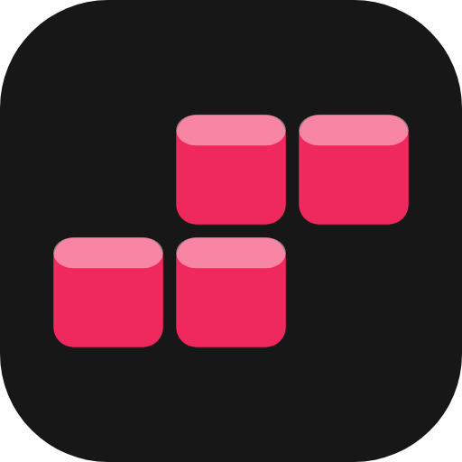

# spawnpoint plugin for Claude

[spawnpoint](https://getspawnpoint.com) is the place where your team's AI lives. With this
plugin, Claude puts the tools, MCP servers, and apps it builds for you online and hands you
a link, in a chat, in Cowork, or in Claude Code. The link is private until you share it,
with one person's email or with everyone at your company, and the people you share it
with never make an account.

## Install

In claude.ai or the Claude desktop app:

1. Open **Customize**, then **Plugins**, then **Add**, then **Add marketplace**, and enter
   `https://github.com/spawnpoint-inc/spawnpoint-plugin`.
2. Install **spawnpoint**, open its **Connectors** tab, and click **Connect**.
3. Sign in to spawnpoint in the browser that opens and click **Approve**.

In Claude Code, one command sets up Claude Code, Codex, Cursor, Copilot, and
[many more agents](https://getspawnpoint.com/agents.html):

```sh
curl -fsSL https://getspawnpoint.com/install | bash
```

Or install just this plugin by hand:

```sh
claude plugin marketplace add spawnpoint-inc/spawnpoint-plugin
claude plugin install spawnpoint@spawnpoint
```

Restart Claude Code, run `/mcp`, select **spawnpoint**, choose **Authenticate**, and
approve in the browser. You sign in once; there are no keys to copy.

Then ask for something: "make a page where my running club says who is coming on
Saturday, and deploy it with spawnpoint." Claude builds it, deploys it, and gives you the
link. Ask it to share the link with a teammate, change the app, or take it down.

## What's in it

The spawnpoint connector (the tools Claude uses to deploy) and three skills, in
[`plugin/spawnpoint/skills/`](plugin/spawnpoint/skills/):

- **`deploy-to-spawnpoint`**: picks the runtime (static, Node, Python, or Docker), sends
  the app, follows the deploy until it is live, and hands back the link. It also covers
  sharing, databases, file storage, MCP servers, and team apps.
- **`security-audit`**: checks an app before it ships. It finds leaked API keys and files
  that should not upload, checks the port and bind address spawnpoint needs, and flags
  debug mode and admin or upload routes with no login. It fixes what is safe to fix and
  stops the deploy on what is not. Run it yourself with `/spawnpoint:security-audit`.
- **`open-models`**: when an app calls OpenAI or Anthropic, asks once whether to run it on
  open models through spawnpoint instead (no provider account, no key), picks the model,
  and makes the edit.

The skills are tested against a mock spawnpoint server before each release, so changes
are measured, not guessed.

## Not using Claude?

spawnpoint is a remote MCP server. Any MCP client can connect to
`https://app.getspawnpoint.com/mcp` (Streamable HTTP, OAuth sign-in in the browser). It is
listed in the [official MCP registry](https://registry.modelcontextprotocol.io) as
`com.getspawnpoint/spawnpoint`. Steps for each agent:
[supported agents](https://getspawnpoint.com/agents.html).

## Update

Run `/plugin`, open **Marketplaces**, select **spawnpoint**, and turn on **auto-update**.
Marketplaces from outside Anthropic have it off by default; after that one toggle, Claude
Code picks up new versions on its own.

To update by hand, run these two commands, then restart Claude Code:

```sh
claude plugin marketplace update spawnpoint
claude plugin update spawnpoint@spawnpoint
```

New MCP tools need no plugin update: agents get them from the server.

## Links

- Docs: [getting started](https://getspawnpoint.com/getting-started.html) and
  [the MCP server and its tools](https://getspawnpoint.com/mcp.html)
- For agents: [llms.txt](https://getspawnpoint.com/llms.txt) and
  [llms-full.txt](https://getspawnpoint.com/llms-full.txt)
- [Security](https://getspawnpoint.com/security.html),
  [privacy](https://getspawnpoint.com/privacy.html), and
  [terms](https://getspawnpoint.com/terms.html)
- Questions and security reports: [mannan@getspawnpoint.com](mailto:mannan@getspawnpoint.com)

This repo is the published plugin only. It is synced from spawnpoint's main repository on
every release.
